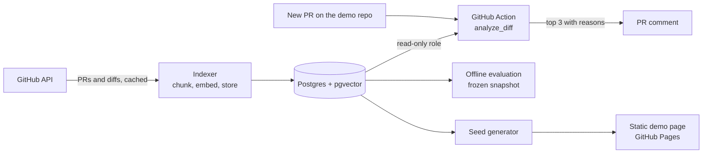

# PR Review Assistant

Finds the past pull requests a reviewer should look at before approving a new one.

**[Live demo](https://harshiltewari2004.github.io/pr-review-assistant/)** · **[Bot on a demo repo](https://github.com/harshiltewari2004/p5-pr-review-demo)** · hybrid retrieval over 3,148 processing/p5.js pull requests

On 20 held-out pull requests, the top suggestion was judged related for all 20, and Recall@3 beat keyword-only search by +0.16 (95% CI +0.07 to +0.28).

Example: [#9309](https://github.com/processing/p5.js/pull/9309) "Add stateful helpers for p5.strands addons", a PR the system had never seen:

1. #8120 Branching and looping for p5.strands: *both modify src/strands/strands_api.js with a similar change pattern*
2. #8923 Support strands shader variable names including double underscores: *both modify src/strands/p5.strands.js with a similar change pattern*
3. #8568 Fix filter() crash on createGraphics(WEBGL) by mirroring strands API: *both modify src/strands/p5.strands.js with a similar change pattern*

## The problem

A pull request rarely arrives in a vacuum. Someone may have fixed the same bug two years ago, settled a design question the new PR reopens, or tried the same change and had it closed. On a large, long-lived project no reviewer remembers all of that, and GitHub search only finds what you already know to look for.

This tool reads the new PR's diff and puts the three most relevant past PRs in front of the reviewer, each with a one-line reason.

## How it works

1. **Chunk.** The diff is split into hunks (the `@@` blocks). Generated, vendored and non-source files are skipped: lockfiles, minified and built bundles, translations, Markdown. Each hunk keeps its function context and drops its line numbers.
2. **Embed.** Every hunk is embedded with `all-MiniLM-L6-v2` (384 dimensions) and stored in Postgres with pgvector.
3. **Find candidates.** Three signals nominate past PRs: vector similarity between hunks (top 50), BM25 over title, body and file names (top 50), and file-path overlap (top 100). Only PRs opened before the new one are eligible.
4. **Score and rank.** All three signals are computed for every candidate, each is min-max normalized across this PR's candidates, and they are combined with weights 0.5 / 0.1 / 0.4 (vector / file overlap / BM25). The top 3 get a template reason. A PR that was closed without merging is flagged, because an earlier abandoned attempt is often the most useful thing a reviewer can see.

Normalizing per query matters. BM25 scores are unbounded and cosine scores are not, so without normalization the weights would not mean what they say.

## Architecture



There is no always-on server. The bot runs the same `analyze_diff` function as the FastAPI service, inside the GitHub Actions runner, and reads the corpus from Neon through a read-only database role. It replies in about a minute. Links in its comments go through `redirect.github.com`, so it never creates backlinks on the upstream p5.js PRs it mentions.

The FastAPI service (`POST /analyze`) and its Dockerfile are included and work locally (CPU-only image, about 520 MB), ready for a host such as Cloud Run. The demo page is static: its examples are produced ahead of time by running the same pipeline on recent PRs the system never indexed, so it loads instantly.

## Evaluation

Held-out results: 20 queries, weights locked beforehand, scored exactly once. All rows come from that single run.

| Configuration | Recall@3, related | Recall@3, strong | MRR@3 |
|---|---|---|---|
| **Hybrid, locked weights 0.5 / 0.1 / 0.4** | **0.43** (95% CI 0.35–0.52) | 0.61 | 1.00 |
| Hybrid, v1.0 weights 0.6 / 0.3 / 0.1 | 0.34 | 0.43 | 0.74 |
| Hybrid, starting weights 0.5 / 0.3 / 0.2 | 0.35 | 0.42 | 0.79 |
| Vector only | 0.33 | 0.39 | 0.73 |
| BM25 only | 0.27 | 0.46 | 0.67 |
| File overlap only | 0.16 | 0.19 | 0.47 |

The best achievable Recall@3 on these queries averages 0.66 (see below), so the locked system reaches about 65% of it. Against BM25 alone, the paired difference in Recall@3 is +0.16 (95% CI +0.07 to +0.28). The result at rank 1 was judged related for 20 of 20 queries, at rank 2 for 12, and at rank 3 for 9.

### How it was measured

- **Queries.** 40 PRs drawn by a seeded random rule across seven areas of the codebase (friendly errors, core, WebGL, p5.strands, image, math, typography), code changes only. 20 for tuning, 20 held out.
- **Candidate pool.** For each query: the top 6 of five retrieval variants, plus the top 3 of every weight setting tuning could pick and of every baseline. 730 (query, candidate) pairs in all. Every top 3 in the table was judged, so no reported number contains an unjudged result.
- **Grades.** Each pair was graded 0, 1 or 2 from one question: would the reviewer of the new PR review worse without having seen this one? 2 means you can name what they would miss (a known failure, a settled design decision, duplicated work). 1 means same area, nothing nameable. 0 means unrelated. "Related" is grade 1 or 2, "strong" is grade 2.
- **Labels.** Grades were proposed by an LLM grader (Claude) shown only the two PRs, with no scores or ranks. As a check, I graded 30 held-out pairs blind before the grader ran. Agreement: quadratic weighted kappa 0.83 (95% CI 0.58–0.96).
- **Tuning.** 66 weight settings in steps of 0.1, scored on the 20 tuning queries only. The held-out set was untouched until the weights were locked and a prediction was written down.
- **Recall@3** is the share of a query's known relevant PRs that land in the top 3. When a query has more than 3 relevant PRs, 1.0 is impossible, which is why the ceiling is reported.
- **Intervals** are bootstrap over queries (1,000 resamples). The BM25 comparison is a paired bootstrap of per-query differences.

### The first round

The first evaluation used 10 tuning and 10 held-out queries. Its tuned weights (0.6 / 0.3 / 0.1) scored 0.32 Recall@3 on held-out and did not beat BM25 alone (0.35). Ten queries were too few, and tuning had underweighted keywords.

Rather than re-tune against that held-out set, I fixed a corpus flaw (built bundles, vendored libraries and generated docs data were inflating similarity), doubled the query set, labeled the new pairs, re-tuned, and scored a fresh held-out set once. Both rounds are reported. The second is the headline because it has twice the queries, not because its number is higher.

### Read with care

- n = 20, and the intervals are wide.
- On the tuning queries, the advantage over BM25 was smaller and not significant (+0.04, CI −0.02 to +0.10).
- Absolute recall is not comparable across query sets. The held-out queries have fewer relevant PRs (median 5.5 vs 7), which raises their ceiling. Relative to the ceiling, held-out (about 65%) is below tuning (about 81%), as you would expect after tuning.
- "Related" is a low bar. The rank-1 result is strongly relevant for 55% of queries.
- Most labels are LLM-proposed. The human check covers 30 pairs, and the lower end of its interval is below 0.6.

## Corpus

| | PRs |
|---|---|
| Fetched from processing/p5.js (snapshot, Aug 2026) | 4,372 |
| Bot-authored | −625 |
| Duplicate resubmissions | −51 |
| Housekeeping | −11 |
| Diff too large for GitHub's API | −19 |
| No source changes left after file exclusions | −518 |
| **In corpus** | **3,148** (37,907 hunks) |

Excluded PRs are marked, not deleted, so the filter can be audited and changed without re-fetching.

## Limitations

- One repository and a frozen snapshot. The live bot uses the same snapshot and does not pick up newer PRs.
- Recall is relative to the judged pool. A relevant PR that no variant retrieved was never graded.
- A candidate's merged or closed status is as of the snapshot, so a PR merged after the new one was opened still shows as merged.
- Half the PRs touch a single file, which makes file overlap a weak signal for them.
- MiniLM is a general English text model applied to code, and hunks longer than 256 tokens are truncated.

## Run it locally

Requires Python 3.11, Docker, and a GitHub token with public read access.

```bash
git clone https://github.com/harshiltewari2004/pr-review-assistant
cd pr-review-assistant
python3.11 -m venv .venv && source .venv/bin/activate
pip install -r requirements.txt -r requirements-dev.txt
cp .env.example .env              # then add your GITHUB_TOKEN
set -a && source .env && set +a
docker compose up -d              # Postgres 16 + pgvector
for f in migrations/*.sql; do psql "$DATABASE_URL_LOCAL" -f "$f"; done
python -m scripts.index_repo processing/p5.js --target local
pytest -q
```

The first index fetches every PR and diff and embeds every hunk, so it takes a few hours. A fresh index also includes PRs opened since the snapshot, so it will not reproduce the published numbers: the scorer checks a corpus fingerprint and refuses to score a corpus its labels were not made on. The frozen pools, labels and results are in `eval/artifacts/`.

## Repository layout

```
app/retrieval/    chunking, embedding, signals, normalization, scoring, reasons
app/              analyze_diff service and FastAPI app
ingest/           GitHub client and corpus filter
scripts/          index_repo.py, seed generator, measurement scripts
eval/             pooling, labeling, agreement, scoring, tuning
eval/artifacts/   frozen pools, labels and results
action/           the GitHub Action
frontend/         the static demo page
migrations/       Postgres schema
```

Code comments cite decision IDs (`D-...`) from my design log.

## Tech

Python 3.11, PostgreSQL 16 with pgvector, sentence-transformers (`all-MiniLM-L6-v2`), rank-bm25, asyncpg, FastAPI, Docker, GitHub Actions, Neon, GitHub Pages.
